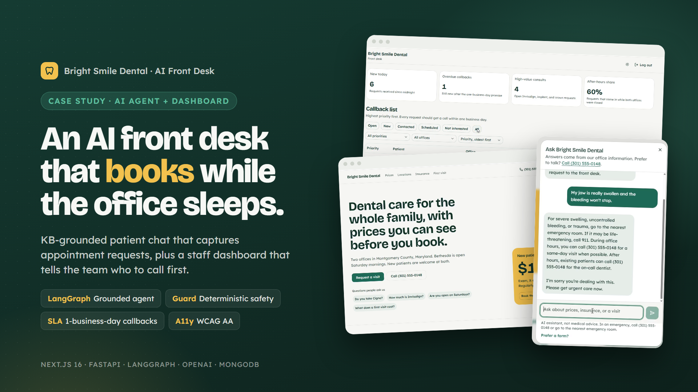
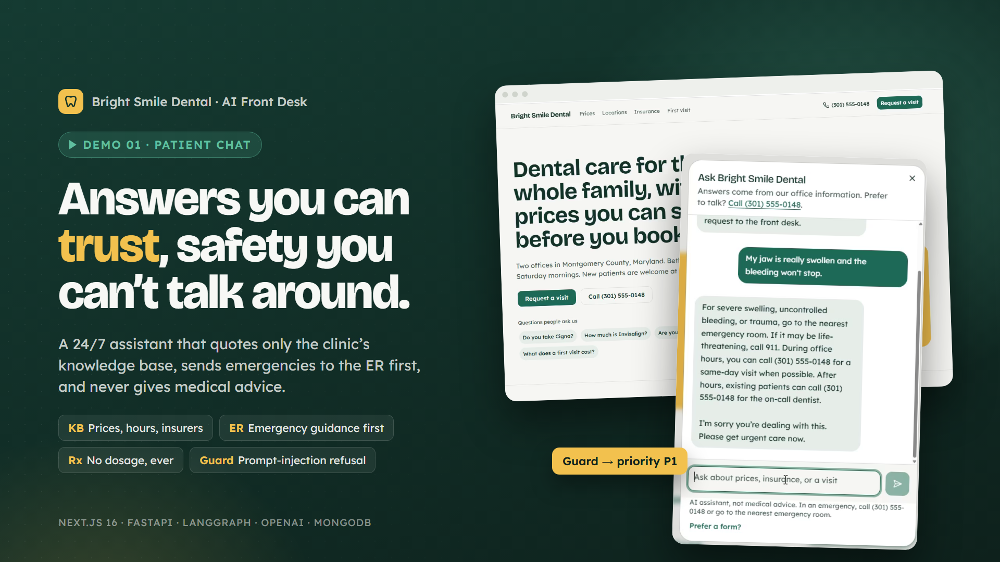
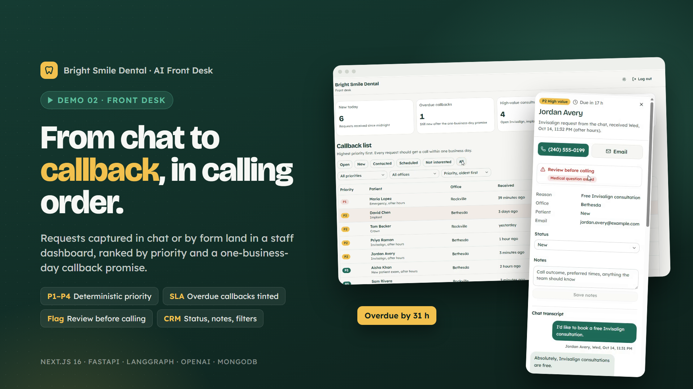

# Bright Smile Dental: AI Front Desk

[][d1]

An AI front desk for a two-office dental practice. A patient chat assistant answers only from the clinic's knowledge base and turns chats into appointment requests 24/7. A staff dashboard ranks every request by who to call first.

**Live demo:** [patient chat](https://bright-smile-agent.vercel.app) · [staff dashboard](https://bright-smile-agent.vercel.app/dashboard) (password `BrightSmile!@#`)

## Demo videos

| | |
| --- | --- |
| [][d1] | [][d2] |
| **[Demo 1: Patient chat][d1]** (2:51) Grounded answers on prices, insurance and hours, then an emergency, a medication question, a "free consult?" trap and a prompt injection. | **[Demo 2: Front desk][d2]** (4:05) Requests captured by chat and form, then the dashboard: priority queue, overdue callback, safety warning, transcript, status and notes. |

Real runs against the live model (OpenAI `gpt-5.4-mini`). Every caption about a reply is backed by an automated check on the screen.

## The problem

New patients could only call during office hours or fill in a form. That left three gaps: evenings and weekends, repetitive questions eating the front desk's day, and no shared way to decide who to call first.

## What I built

- **Patient chat assistant.** Answers from the knowledge base only, offers the clinic's own deals when relevant ($149 new-patient visit, $29/month membership, free Invisalign consult), and captures a validated request (name, phone, email, office, consent).
- **Safety by design.** Emergencies get ER and 911 guidance first. No medical, dental or medication advice. A deterministic guard flags medical questions and injection attempts, so safety does not depend on the model.
- **Front-desk dashboard.** One queue ordered P1 to P4 (emergencies, high-value consults, new patients, the rest), a countdown to the one-business-day promise, overdue rows tinted, one-tap call and email, full transcript, status and notes, filters kept in the URL.
- **Practice website.** Prices, hours and insurers rendered from the assistant's knowledge base, so the two never disagree.

## Business value

- Requests captured 24/7, including when both offices are closed. The dashboard reports the after-hours share.
- High-value cases (Invisalign, implants, crowns) are never buried under routine requests.

## Engineering highlights

- **Grounding over RAG:** the knowledge base is about one page, so it lives in the prompt in full. Nothing is missed by retrieval.
- **Rules in code, not in the model:** priority, SLA deadlines, after-hours detection and safety flags are pure, unit-tested functions.
- **Quality bar:** 157 backend tests and 24 frontend tests, plus **12 of 12 live golden evaluations** against the real model. The first eval run caught a provider-side tool-call defect that no mocked test could.
- **Typed end to end:** `mypy --strict`, Pydantic v2 everywhere, and frontend types generated from the OpenAPI schema. CI fails on drift.
- **Accessible:** keyboard, focus, `aria-live` chat, WCAG AA contrast.

## Stack

| Layer | Technology |
| --- | --- |
| AI | LangGraph, OpenAI via `langchain-openai`, Responses API |
| Backend | Python 3.12, async FastAPI, SSE, MongoDB (Beanie), uv, ruff, mypy |
| Frontend | Next.js 16 (App Router), TypeScript strict, shadcn/ui, Tailwind CSS, Vitest |
| Delivery | GitHub Actions, Render, Vercel, MongoDB Atlas |

## My role

Solo build, end to end: spec, agent, backend, frontend, tests and evals, CI/CD and deployment.

[d1]: https://github.com/kevinkamto/bright-smile-dental-agent/releases/download/portfolio-v1/demo-1-patient-chat.mp4
[d2]: https://github.com/kevinkamto/bright-smile-dental-agent/releases/download/portfolio-v1/demo-2-front-desk.mp4
